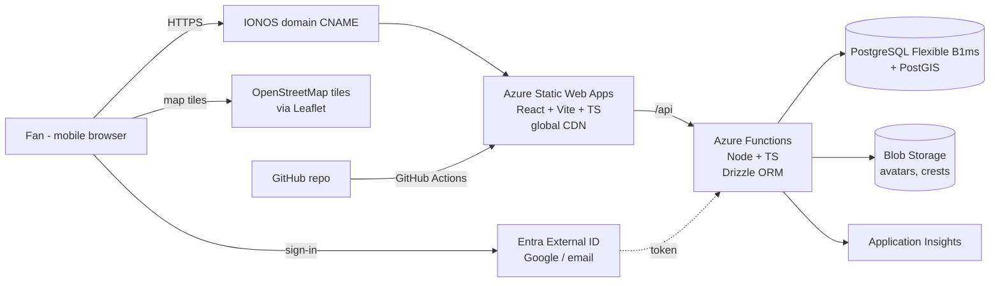

# Project Siro – System Architecture (MVP)

Jira: SIRO-16

## Components
| Layer | MVP | Scaling path |
|---|---|---|
| Frontend | React + Vite + TypeScript on Azure Static Web Apps | Azure Front Door if needed |
| API | Azure Functions (Node, TS) under `/api` | Flex Consumption / Container Apps |
| Database | PostgreSQL Flexible Server B1ms + PostGIS | Scale up, read replicas |
| ORM / migrations | Drizzle | — |
| Auth | Microsoft Entra External ID | — |
| Files | Azure Blob Storage | — |
| Monitoring | Application Insights | Alerts, dashboards |
| Maps | Leaflet + OpenStreetMap | Paid tile provider at volume |
| Live (post-MVP) | — | Redis (check-in counts), Web PubSub (live map) |

## Environments
- **Local:** Vite dev server + Functions Core Tools + Postgres/PostGIS in Docker
- **Preview:** auto-created per pull request by Static Web Apps
- **Prod:** IONOS domain → Static Web Apps

## Principles
- Stateless API so it scales horizontally.
- All location queries done in PostGIS (spatial indexes on every `geography` column).
- Secrets in app settings / Key Vault, never in the repo.
- Keep cost near zero until there are real users; every upgrade above is additive, not a rewrite.

## OSM tile note
OpenStreetMap's public tile servers have a fair-use policy that suits a small MVP. Switch to a commercial tile provider before significant traffic.
