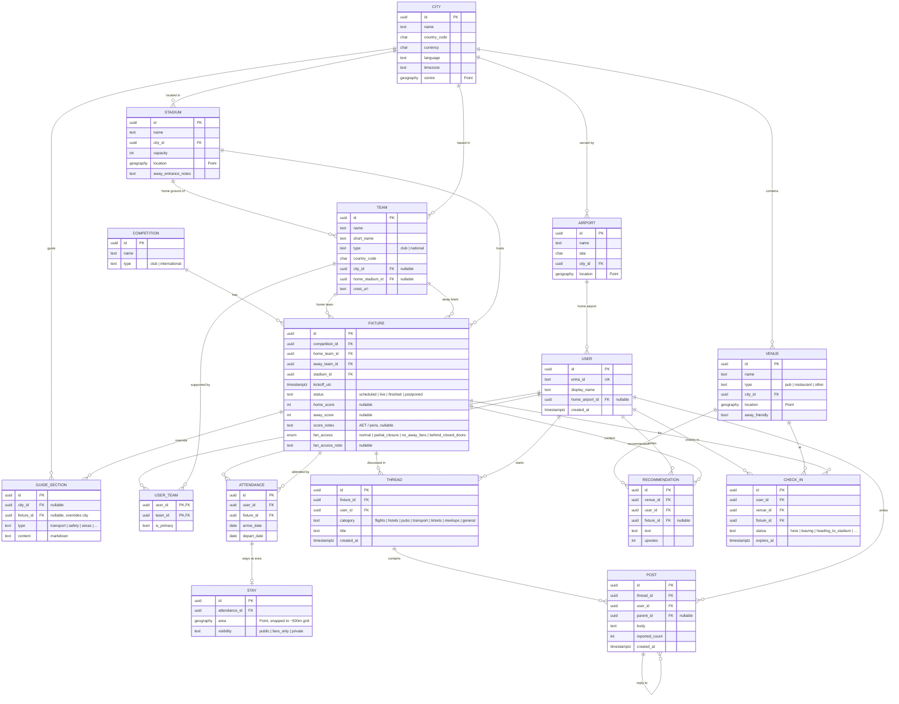

# Project Siro – MVP Data Model

Jira: SIRO-15 · Database: Azure PostgreSQL Flexible Server + PostGIS

## Key rules
- **Fixture is the hub** – most activity hangs off it.
- **No exact user locations** – `STAY.area` is snapped to a ~500m grid on save.
- **Check-ins expire** – counts only include rows where `expires_at > now()`; no deletes needed.
- **Guides are reusable** – city-level sections, with optional fixture-level overrides.
- **Stadiums can be shared** – Team → home stadium; Fixture has its own stadium (neutral venues/finals).
- **Internationals ready** – `TEAM.type` and `COMPETITION.type`; national teams have no city.

## Implementation notes (SIRO-22)
Source of truth is now `db/src/schema.ts`. Small additions made while implementing:
- `fixtures.stage` (e.g. "League phase"); check that home and away teams differ.
- `fixtures.fan_access` reflects UEFA sanctions ("Sanctions affecting supporter attendance"). `no_away_fans` and `behind_closed_doors` show a "don't travel" warning and the API refuses "I'm going"; `partial_closure` shows a caution only.
- `guide_sections.title` and `sort_order`; check that a section belongs to a city or a fixture.
- `users.is_admin` for the admin journey; table is `users` (`user` is reserved in Postgres).
- `posts.hidden` for moderation.
- `created_at` on all activity tables; unique attendance per user per fixture.
- Location columns are plain `geography` (SRID 4326 default) – drizzle-kit can't emit `geography(Point,4326)`.

## Sign-in (SIRO-6)
- `users.entra_id` replaced by `auth_provider` (`github` | `aad`) + `auth_user_id`, unique together (ADR-0009). No email addresses are stored.
